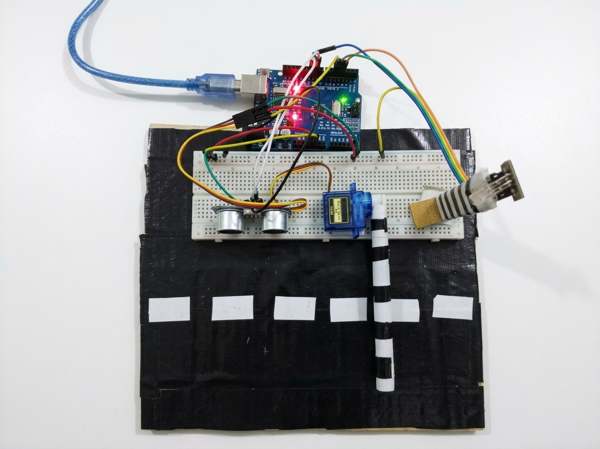
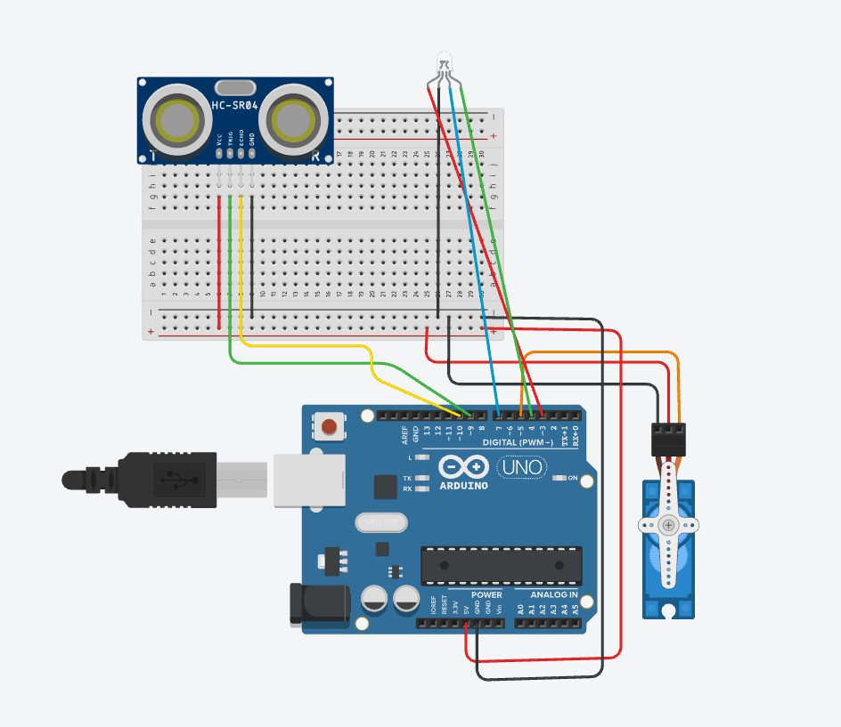

# Arduino-Automatic-Gate-System

A simple automatic gate built with an Arduino, an ultrasonic sensor, a servo motor and LEDs. When an object comes within 15 cm of the sensor, the gate opens. When the object moves away, the gate closes.

## Circuit Diagram

## Features

- Detects approaching objects with an HC-SR04 ultrasonic sensor
- Opens and closes a miniature gate with a servo motor
- LED status indicators (green = open, red = closed, blue = no reading)
- Distance output on the Serial Monitor for debugging

## Components

| Part | Quantity |
|---|---|
| Arduino Uno (or compatible) | 1 |
| HC-SR04 ultrasonic sensor | 1 |
| Servo motor (e.g. SG90) | 1 |
| LEDs: red, green, blue | 1 each |
| 220 ohm resistors | 3 |
| Breadboard and jumper wires | as needed |

## Wiring

| Component | Arduino pin |
|---|---|
| Red LED (+) | 3 |
| Green LED (+) | 4 |
| Blue LED (+) | 7 |
| Servo signal | 5 |
| Ultrasonic TRIG | 9 |
| Ultrasonic ECHO | 10 |
| Ultrasonic VCC / GND | 5V / GND |
| Servo VCC / GND | 5V / GND |

Each LED's negative leg goes to GND through a 220 ohm resistor.

## How it works

1. The Arduino sends a short pulse from the TRIG pin.
2. The sensor returns an echo, and the Arduino measures how long it takes.
3. The time is converted into a distance in centimeters.
4. If the distance is 15 cm or less, the servo moves to 10 degrees (gate open) and the green LED turns on.
5. Otherwise, the servo moves to 90 degrees (gate closed) and the red LED turns on.
6. If no echo is received, the blue LED turns on.

## Getting started

1. Build the circuit using the wiring table above.
2. Open `automatic_gate/automatic_gate.ino` in the Arduino IDE.
3. Select your board and port under the Tools menu.
4. Upload the sketch.
5. Open the Serial Monitor at 9600 baud to see live distance readings.

## Settings you can change

- **Detection distance:** change `15` in `if (distance <= 15)`.
- **Open and closed angles:** change the values in `myServo.write(10)` and `myServo.write(90)` to match your gate.

